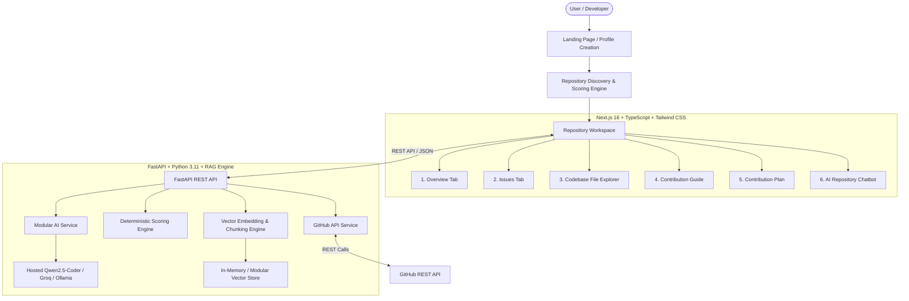

# ContribMate AI

> **"Find your first meaningful open-source contribution."**

ContribMate AI is an AI-powered open-source contribution mentor. It guides beginners from *"I want to contribute to open source"* to *"I know exactly which repository, which issue, which files, and what I should do."*

ContribMate AI is **NOT** a replacement for GitHub — GitHub remains the source of truth. ContribMate AI operates as an intelligent recommendation, repository RAG, difficulty scoring, and step-by-step guidance layer on top of public GitHub data.

---

## 📐 Architecture Overview



---

## ✨ Features

1. **User Profile & Preference Matching**: Collects coding experience, tech skills, domain interests, and available time.
2. **Deterministic Recommendation Scoring**: Programmatically calculates repository match scores across skills (30%), interests (20%), experience (20%), issue availability (15%), activity (10%), and complexity (5%).
3. **Repository Workspace**: Central hub per repository with Overview, Issues, Codebase Explorer, Contribution Guide, Step-by-Step Plan, and AI Chat.
4. **Filtered GitHub Issues**: Displays open issues while strictly filtering out pull requests. Rates issue difficulty (`🟢 Beginner`, `🟡 Intermediate`, `🔴 Advanced`).
5. **Zero-Hallucination Evidence System**: Classifies file references into `✓ VERIFIED`, `⚠ LIKELY`, or `? NEEDS VERIFICATION`.
6. **⭐ Grounded Repository AI Mentor**: RAG-powered chatbot indexing README, documentation, and source code trees to answer repository questions with clickable source links.
7. **Instant Demo Mode**: Works out-of-the-box with fallback demo datasets when API keys are not provided.

---

## 🛠️ Technology Stack

- **Frontend**: Next.js 16 (App Router), TypeScript, Tailwind CSS, Lucide React, React Hook Form, Zod, TanStack Query.
- **Backend**: Python 3.11, FastAPI, Pydantic v2, SQLAlchemy, httpx, uvicorn.
- **RAG & Vector Search**: Modular TF-IDF + Character N-Gram embedding vector store with cosine similarity.
- **AI Model**: Open-weight `Qwen-2.5-Coder-32b` (via Groq / Hosted OpenAI-compatible / Ollama).
- **Database**: SQLite (default) / PostgreSQL compatible via SQLAlchemy.

---

## 🚀 Quick Start Guide

### Prerequisites
- **Node.js**: v18+ (v22 tested)
- **Python**: v3.11+
- **Git**

---

### 1. Backend Setup

```bash
# Navigate to root directory
cd Contribmate-AI

# Create Python virtual environment
python -m venv backend/venv

# Activate virtual environment (Windows PowerShell)
.\backend\venv\Scripts\Activate.ps1

# Activate virtual environment (Linux/macOS)
# source backend/venv/bin/activate

# Install backend dependencies
pip install -r backend/requirements.txt

# Run Pytest suite
$env:PYTHONPATH="backend"
pytest backend/tests

# Start FastAPI server
uvicorn app.main:app --host 0.0.0.0 --port 8000 --reload
```

Backend API will be running at `http://localhost:8000`. OpenAPI docs available at `http://localhost:8000/docs`.

---

### 2. Frontend Setup

```bash
# Open a new terminal in root directory
cd Contribmate-AI/frontend

# Install dependencies
npm install

# Run frontend development server
npm run dev
```

Frontend application will be running at `http://localhost:3000`.

---

## 🔑 Environment Variables (`.env`)

Copy `.env.example` to `.env` in the root directory:

```env
# GitHub REST API Token (Optional, increases rate limits)
GITHUB_TOKEN=

# AI Provider Credentials (Hosted Qwen via Groq or OpenAI-compatible endpoint)
GROQ_API_KEY=your_groq_api_key_here
AI_MODEL=qwen-2.5-coder-32b
AI_BASE_URL=https://api.groq.com/openai/v1

# Database Configuration
DATABASE_URL=sqlite:///./contribmate.db

# Frontend API URL
NEXT_PUBLIC_API_URL=http://localhost:8000

# Demo Mode (Set true for mock data fallback if keys are omitted)
DEMO_MODE=true
```

---

## 🧪 Running Tests

### Backend Tests
```bash
# Run pytest with PYTHONPATH set
$env:PYTHONPATH="backend"; .\backend\venv\Scripts\pytest backend/tests
```

### Frontend Build Verification
```bash
cd frontend
npm run build
```

---

## 📄 License

This project is licensed under the [MIT License](LICENSE).
